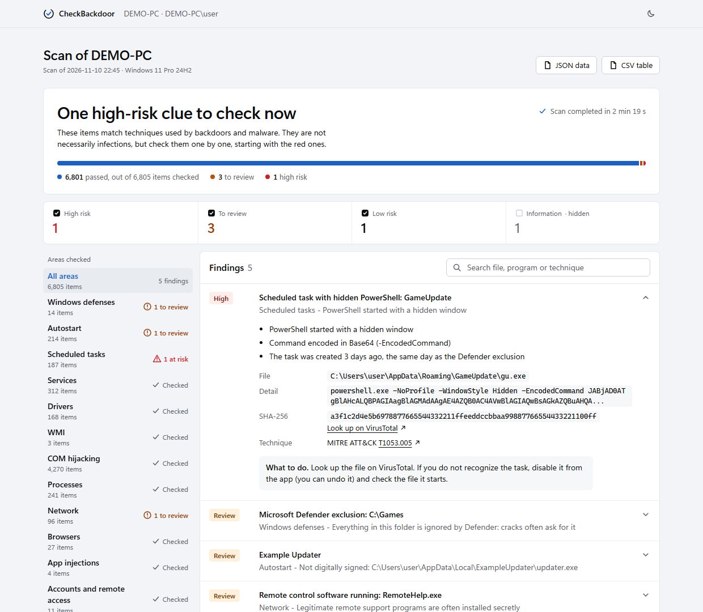
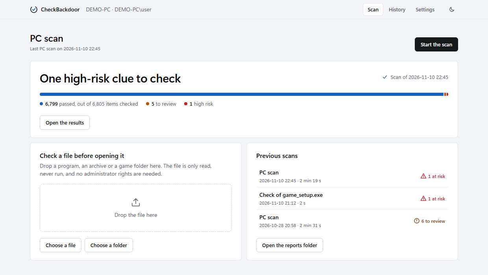

# CheckBackdoor

A Windows scanner that looks for **backdoors, RATs, cryptominers and other signs of compromise**,
made for people who downloaded executables, cracks or games from unofficial sources.

- **Read-only scan**: the scan does not change, delete or quarantine anything. The app disables
  an item only if you ask, always with a backup and an Undo button.
- **The script needs no installation**: it uses PowerShell 5.1, already present in every
  Windows 10/11.
- **No data sent** to the internet (except hashes, and only if you turn on VirusTotal).
- A readable **HTML** report, plus **JSON** and **CSV**. The report works offline: opening it
  makes no request to the internet.



*A report with invented example data.*

> **Warning.** CheckBackdoor is a second opinion, not an antivirus. It looks for the traces a
> backdoor leaves to start and communicate, but a rootkit that is already active can hide from
> Windows itself. "No clues" **does not guarantee** that the PC is clean: if you have good
> reasons to doubt, also use Microsoft Defender Offline and, on PCs with important data,
> consider reinstalling Windows. The software is provided "as is", without warranty (see
> [LICENSE](LICENSE)). Download it only from this repository: read [SECURITY.md](SECURITY.md).

## Download

From the [**Releases**](../../releases) page:

| File | What it is |
|---|---|
| `CheckBackdoor-<version>-setup.exe` | Installer. Installs to Program Files, so it asks for administrator rights. |
| `CheckBackdoor-<version>-win-x64.zip` | Portable app: extract it and start `CheckBackdoor.exe`. |
| `CheckBackdoor-<version>-script.zip` | The PowerShell engine only, for those who prefer the script. |
| `SHA256SUMS.txt` | Hashes to verify the downloaded files (`Get-FileHash file -Algorithm SHA256`). |

If the files are not signed, Windows SmartScreen shows a warning: choose *More info* and then
*Run anyway*, only after checking the hash.

If there is no release yet, use **Code → Download ZIP** on this page and extract it: it contains
the script version, ready for the quick start below. Extract it to a folder that only
administrators can change (see [SECURITY.md](SECURITY.md)), because the scan runs its files
as administrator.

## Quick start

1. Double-click **`Start-Scan.bat`**.
2. Accept the administrator prompt (without it, some important checks such as Defender
   exclusions and WMI are incomplete).
3. At the end the report opens in the browser. The files stay in the `report\` folder.

From PowerShell:

```powershell
powershell -ExecutionPolicy Bypass -File .\CheckBackdoor.ps1
```

### App with an interface

In `app\` there is the Windows app. It offers:



- the Home with the latest verdict;
- the scan in progress, with the areas ticking off live and a Cancel button;
- checking a file by dropping it on the window;
- the results with the same look as the report, with an action on each finding:
  - **Show the file** in File Explorer;
  - **Ignore in future scans** (restored from the settings);
  - **Disable**, for startup entries, files in the Startup folder, scheduled tasks and
    services. It never deletes anything: it saves a backup first, and **Undo** puts everything
    back as it was;
- the scan **History** and the **Comparison** between two scans: new and gone findings, items
  added, changed (usually updates) and removed;
- the **Settings**: VirusTotal key (encrypted with DPAPI for your Windows user, it never goes
  through the command line), weekly **scheduled scan**, changes made with their Undo, ignored
  items.

The app runs as a normal user: only the scan and the actions that touch system parts (HKLM,
tasks, services) ask for administrator rights. The interface loads nothing from the internet.
Reports, backups and settings stay in `%LOCALAPPDATA%\CheckBackdoor`; backups of changes made
as administrator go to `%ProgramData%\CheckBackdoor\backup`, which only administrators can write.

The scheduled scan is a Task Scheduler task of the user (`\CheckBackdoor\Weekly scan`) and
runs without administrator rights. CheckBackdoor recognizes it as its own only if it runs
exactly its own `CheckBackdoor.ps1` (same content): a task with the same name that runs
something else is flagged like the others.

To build it you need the .NET 10 SDK (`winget install Microsoft.DotNet.SDK.10`):

```powershell
dotnet build app\CheckBackdoor.App -c Release
.\app\CheckBackdoor.App\bin\Release\net10.0-windows\CheckBackdoor.exe
```

### Check a file before opening it

Drop a file (or a folder) on **`Check-File.bat`**. Or:

```powershell
.\CheckBackdoor.ps1 -File "$env:USERPROFILE\Downloads\setup.exe"
```

The file is only read, never run, and no administrator rights are needed. The check covers:

- the **digital signature**: missing, valid or tampered;
- the **site it was downloaded from**;
- **misleading names**: `photo.jpg.exe`, the invisible character that reverses the text,
  spaces before the extension;
- the **packers** used to hide code (UPX, Themida, VMProtect...);
- executables **inflated with zeros** to exceed the limits of antivirus products and
  VirusTotal (a typical stealer trick);
- **zip archives** that contain shortcuts or double extensions;
- in game folders, **replaced DLLs**: unsigned copies of Windows DLLs, which the program
  would load instead of the originals, and game client DLLs changed by a crack.

With `-VirusTotalApiKey` it checks the hash even when it finds no clues. The results are named
`check_*` and do not interfere with the comparison between scans. The allowlist does not apply
here: if you ask to check a file, you always see the result.

## Options

| Parameter | What it does |
|---|---|
| `-File path` | Checks only that file or folder, before opening it (see above). |
| `-Deep` | Deeper scan of the user folders, DLLs included. Slower. |
| `-CompareLast` | Compares with the last scan and shows **what changed**. |
| `-CompareTo file.json` | Compares with a specific scan. |
| `-VirusTotalApiKey KEY` | Looks up the hashes of suspicious files on VirusTotal (or the `VT_API_KEY` variable). |
| `-VirusTotalKeyFile file` | As above, with the key encrypted with DPAPI for the current user (the app writes it). |
| `-AllowlistFile file` | An extra allowlist (the app keeps the items you chose to ignore there). |
| `-VirusTotalMax 20` | Maximum number of hashes to look up (free API: 4 per minute). |
| `-Skip Network,FileSystem` | Skips some checks. |
| `-NoOpen` | Does not open the report at the end. |
| `-NoElevate` | Does not ask for administrator rights. |
| `-EventsFile file.jsonl` | Writes progress and findings as they arrive, for an interface that follows the scan ([format](docs/EVENTS.md)). |
| `-Quiet` | No console output; with `-EventsFile`, the administrator window stays hidden too. |

Exit code: `2` = high-risk items found, `1` = items to review, `0` = nothing,
`3` = scan cancelled, `4` = CheckBackdoor files are missing (usually quarantined by the antivirus).

### The most useful trick: before and after

Before trying a program you do not trust:

```powershell
.\CheckBackdoor.ps1                 # baseline scan
# ...install/start the program, restart the PC...
.\CheckBackdoor.ps1 -CompareLast    # shows every new startup entry, service, exclusion...
```

This way you see exactly what it added to the system.

## What it checks

| Module | Checks |
|---|---|
| **Windows defenses** | Defender off, **exclusions** (the number one sign of cracks), policies that turn it off, history of detected threats, Windows Update/firewall disabled or removed, UAC, accessibility programs replaced (sethc/utilman), forced boot into Safe Mode |
| **Autostart** | Run/RunOnce keys of all users, Startup folders, Winlogon, IFEO, SilentProcessExit, AppInit_DLLs, LSA, BootExecute, Netsh, print monitors, Active Setup, cmd AutoRun, logon scripts, screensaver, COM hijacking, moved Startup folder, PowerShell profiles, BITS jobs with a command, AppCertDlls, compatibility databases (SDB), Office add-ins and the "Office test" key, Winsock providers |
| **Scheduled tasks** | All actions, hidden tasks (Tarrask technique), tasks that blend in under `\Microsoft\`, tasks present only as XML files |
| **Services and drivers** | Executable or DLL of every service, unsigned drivers (rootkits), Safe Mode services (Crackonosh), RDP Wrapper |
| **WMI** | Permanent subscriptions that run commands ("fileless" persistence) |
| **Processes** | Processes disguised as system processes, look-alike names (svch0st), unusual parents, suspicious command lines, **unusual CPU usage (miners)** |
| **Network** | Listening ports, connections to public IPs, ports of known RATs, hosts file, proxy, firewall, remote control software (AnyDesk, NetSupport...), SSH server |
| **Browsers** | Extensions of Chrome, Edge, Brave, Opera, Vivaldi and Firefox: those flagged by the browser as malware, loaded from a folder or the command line, forced by a policy, not from a store or updated from a private server. Policies that hijack search, home page or proxy, or block the developer tools. Browser shortcuts and processes started with `--load-extension` or `--remote-debugging-port` (used by stealers to steal cookies). It reads only extension data, never history, cookies or passwords |
| **App injections** | Code added to Discord, Discord Canary/PTB and Lightcord (the `index.js` file stealers change to steal the token at every start; BetterDiscord recognized) and to the Exodus and Atomic wallets (code changed after installation or with data exfiltration channels) |
| **Accounts** | Unknown administrators, hidden accounts, Administrator/Guest enabled, Remote Desktop, WinRM |
| **Certificates** | Added root certificates (HTTPS interception) |
| **Suspicious files** | Unsigned executables, VBS/JS/HTA scripts, hidden files, random names and ADS streams in AppData, Temp, ProgramData, Public, Recycle Bin |
| **Timeline** | Last 30 days from the Windows logs: services installed and then removed (7045), Defender turned off or given exclusions (5001, 5007), threats found and not removed (1116-1119), accounts created or made administrators (4720, 4732), suspicious PowerShell scripts (4104) and programs started from Downloads, Desktop or Temp (BAM key). The report has a section with the events in date order. |

Each item gets a **score** from combined clues (missing or tampered digital signature, folder
writable by the user, random name, hidden file, obfuscated commands, downloaded from the
internet, LOLBins...) and then a level: **High**, **Medium** (to review), **Low**, **Info**.
Each result gives the reason, the MITRE ATT&CK technique and what to do.

For details on how backdoors hide and which check matches which technique, read
[docs/HOW-THEY-HIDE.md](docs/HOW-THEY-HIDE.md).

## How to read the report

- **Red (High)**: matches a technique typical of malware. Check it right away.
- **Orange (Medium)**: often legitimate (many programs are unsigned or live in AppData), but
  make sure you recognize it.
- **Grey (Low / Info)**: for completeness.

For each suspicious file there is a link to look it up on VirusTotal by its SHA-256.

Items you have checked and found legitimate can be hidden by adding them to
`allowlist.local.json` (paths with `*`, SHA-256 hashes or titles). Create it by copying
`allowlist.json`: the `.local` file is excluded from git, so your personal list never ends up
in the repository, just like the `report\` folder. Rules that are too broad (such as `*` or a
whole `AppData` folder) are not applied and are flagged in the report, and everything the
allowlist hides is still listed at the bottom of the report.

```json
{
    "paths": ["C:\\Users\\*\\AppData\\Local\\Discord\\*"],
    "sha256": ["0123ABCD..."],
    "titles": ["*Steam*"]
}
```

## If you find something

1. Do not delete it right away: note the path and check the file on virustotal.com.
2. If it is confirmed malicious, disconnect the PC from the internet.
3. Run **Microsoft Defender Offline** and a second scanner (Malwarebytes, ESET Online Scanner).
4. Remove the startup entries first (task, Run key, service), then the files.
5. From **another device** change your passwords (email first) and turn on two-step verification.
6. When in doubt, reinstall Windows: it is the only way to be sure.

## If your antivirus blocks CheckBackdoor

To find malware, CheckBackdoor reads the same places of the system that malware reads: the
startup keys, browser extensions, the files of Discord and of wallets. And its files contain
the words it looks for (obfuscated commands, miner parameters...). Some antivirus products,
especially those with behavior analysis such as Kaspersky, may mistake it for a threat and
quarantine `CheckBackdoor.ps1` or a module without warning.

You notice it because `Start-Scan.bat`, the script or the app tell you a file is missing.

1. **Restore the file from the antivirus quarantine** (in Kaspersky: *Detections* or
   *Quarantine*), or download the project again. With git, `git checkout -- .` is enough.
2. **Add the folder to the antivirus exclusions.** In Kaspersky: *Settings*, *Security
   settings*, *Threats and exclusions*, *Manage exclusions*, *Add*, and choose the CheckBackdoor
   folder. In Microsoft Defender: *Windows Security*, *Virus & threat protection*, *Manage
   settings*, *Exclusions*.
3. **Report the false positive** to the antivirus vendor, so it improves for everyone
   (Kaspersky accepts files for analysis at opentip.kaspersky.com).

Before excluding the folder, make sure you downloaded CheckBackdoor from its repository: all
the code is readable, which is why it is written in PowerShell. An exclusion applies only to
that folder: do not put other files there.

## Limits

CheckBackdoor finds the **traces** a backdoor must leave to survive and communicate. It cannot
see a kernel rootkit that is already active (it can hide from the operating system itself),
malware that lives only in memory, or a stealer that already stole the data and deleted itself.
It does not replace an antivirus: it is a targeted second opinion.

## Layout

```
CheckBackdoor.ps1        main script
Actions.ps1              "Disable" with a backup and "Undo" (used by the app)
Start-Scan.bat           start with a double click
Check-File.bat           drop a file here to check it before opening it
allowlist.json           allowlist example (yours goes in allowlist.local.json)
modules/
  Common.ps1             findings, inventory, allowlist, file information
  CommandRisk.ps1        command-line analysis and risk score
  Persistence.ps1        startup locations in the registry and Startup folders
  AutorunExtra.ps1       lesser-known startup locations (PowerShell profiles, BITS, Office, Winsock...)
  ScheduledTasks.ps1     scheduled tasks
  Services.ps1           services and drivers
  Wmi.ps1                WMI subscriptions
  Processes.ps1          processes and CPU
  Network.ps1            network, hosts, proxy, firewall, remote access
  Browser.ps1            browser extensions, policies and shortcuts
  Injections.ps1         code injected into Discord and wallets
  FileCheck.ps1          checking a file before opening it (-File)
  Security.ps1           Defender and Windows defenses
  Accounts.ps1           accounts and Remote Desktop
  Certificates.ps1       root certificates
  FileSystem.ps1         suspicious files
  Timeline.ps1           timeline from the event logs and the BAM key
  VirusTotal.ps1         optional hash lookup
  Report.ps1             HTML/JSON/CSV report, comparison, allowlist
  Remedy.ps1             actions on findings, with backup and undo
app/CheckBackdoor.App/   app with an interface (.NET 10, WPF + WebView2)
  ScanRunner.cs          starts the engine and follows its events
  ActionRunner.cs        runs Actions.ps1 (as administrator when needed) and the scheduled scan
  Stores.cs              VirusTotal key (DPAPI), ignored items, backups, settings
  ReportStore.cs         history, summaries and comparison between two scans
  MainWindow.xaml.cs     window, locked-down navigation, bridge to the interface
  ui/                    HTML/CSS/JS interface (outside the app it shows demo data)
installer/               Inno Setup script
tools/                   release build and detection test in a VM
docs/
  HOW-THEY-HIDE.md       hiding techniques and sources
  EVENTS.md              event format between engine and app
  VALIDATION.md          how to measure detections in a virtual machine
  images/                screenshots for this README (invented example data)
tests/                   Pester tests (see "Development and tests")
```

## Development and tests

```powershell
.\tools\Build-Release.ps1      # release packages in dist\ (tests, app, installer, hashes)
```

- **Detection test in a virtual machine**: `tools\Test-Detections.ps1` creates *harmless*
  persistence (Run entry, task, service, WMI, Defender exclusion... whose payload is a
  `Write-Output`), runs the scan, tells which ones it found and removes everything. It refuses
  to start outside a VM. See [docs/VALIDATION.md](docs/VALIDATION.md).
- **Release**: a `v1.2.0` tag prepares a **draft** release on GitHub with installer, zips and
  hashes. With the `SIGNING_PFX_BASE64` and `SIGNING_PFX_PASSWORD` secrets (a code signing
  certificate from a recognized authority) it signs the exe, scripts and installer.

The tests use [Pester](https://pester.dev) 5 or later and also run on GitHub Actions at every
change, with Windows PowerShell 5.1 (`.github/workflows/test.yml`).

```powershell
Install-Module Pester -Scope CurrentUser -SkipPublisherCheck   # once
.\tests\Invoke-Tests.ps1                    # all tests (about a minute)
.\tests\Invoke-Tests.ps1 -ExcludeTag E2E    # without the real scans (a few seconds)
```

| File | What it checks |
|---|---|
| `tests\Common.Tests.ps1` | Paths, risk score, suspicious command lines, allowlist |
| `tests\Report.Tests.ps1` | Safe offline HTML (names chosen by an attacker stay text), allowlist, comparison between scans |
| `tests\Browser.Tests.ps1` | Extensions on a fake Chromium profile, shortcut parameters |
| `tests\FileCheck.Tests.ps1` | Executable analysis on files built on the fly (double extension, reversed text, inflated, UPX, archives, replaced DLLs) |
| `tests\Timeline.Tests.ps1` | Timeline on fake events: vanished services, Defender, accounts, PowerShell scripts, BAM key |
| `tests\AutorunExtra.Tests.ps1` | Moved Startup folder, PowerShell profiles, bitsadmin output, Winsock catalog, task XML |
| `tests\Injections.Tests.ps1` | Clean, injected and BetterDiscord Discord; intact and tampered wallets |
| `tests\Remedy.Tests.ps1` | Disable and Undo on a test key in HKCU and on test files; disallowed actions rejected |
| `tests\Static.Tests.ps1` | Syntax, ASCII encoding where needed, no network requests outside VirusTotal, no personal data in published files |
| `tests\EndToEnd.Tests.ps1` | Real scans with `powershell.exe`, report and comparison |

The malicious command samples in the tests are harmless and assembled at runtime: written out
in full they would be blocked by Microsoft Defender (AMSI) before even running.

The development plan is in [ROADMAP.md](ROADMAP.md).

### Why PowerShell

It is built into Windows (no dependency to install, which would be one more attack surface on
a possibly compromised PC), it has native access to the registry, WMI/CIM, Authenticode
signatures, Microsoft Defender, Task Scheduler and the network stack, and the code is
readable: you can check for yourself that the scanner does nothing strange.
